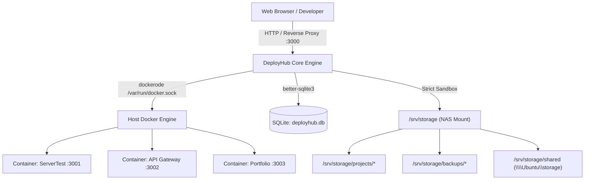
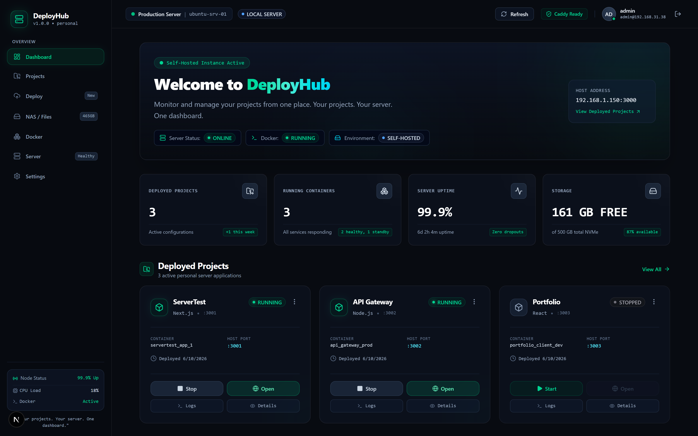
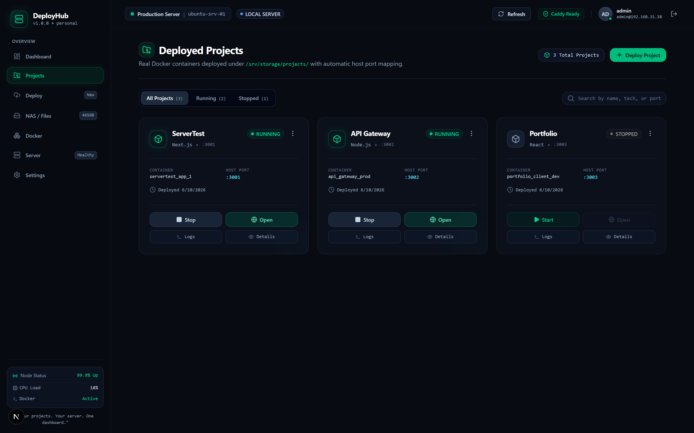
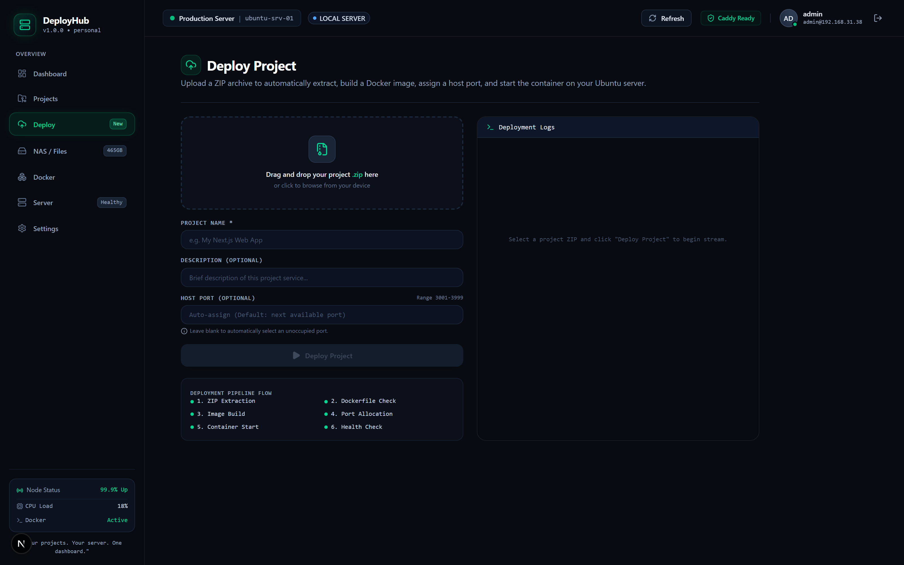
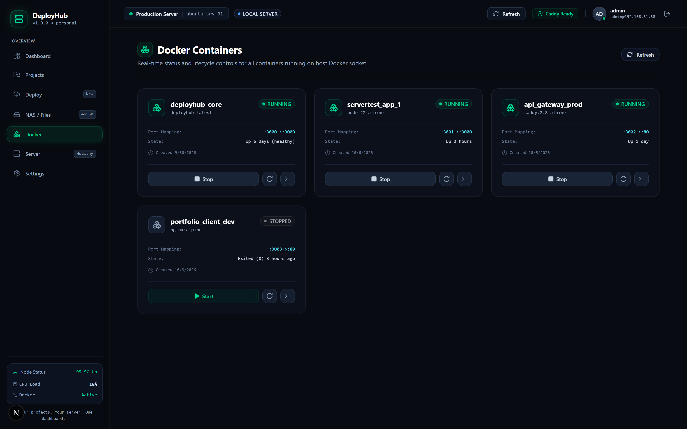
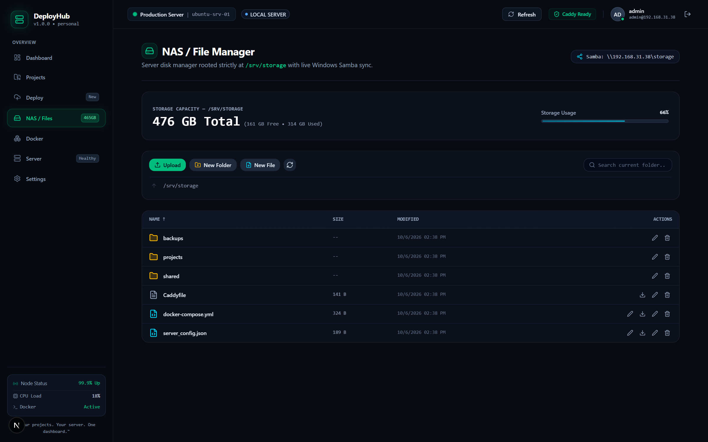
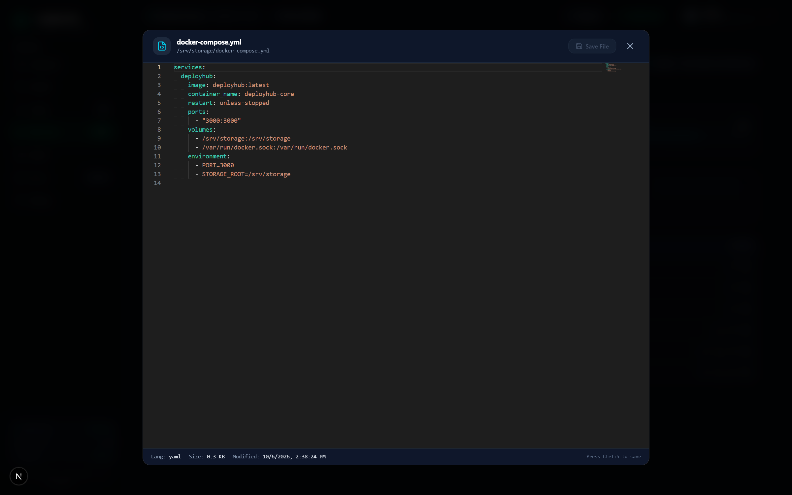
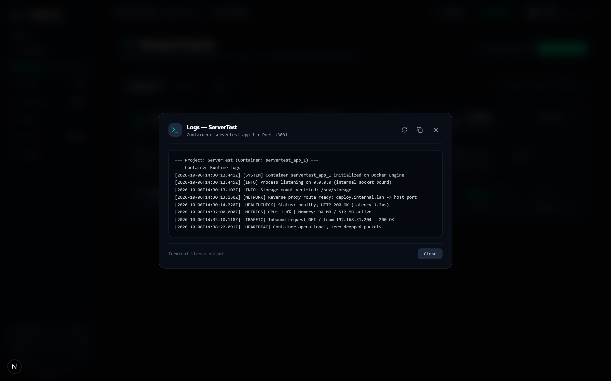
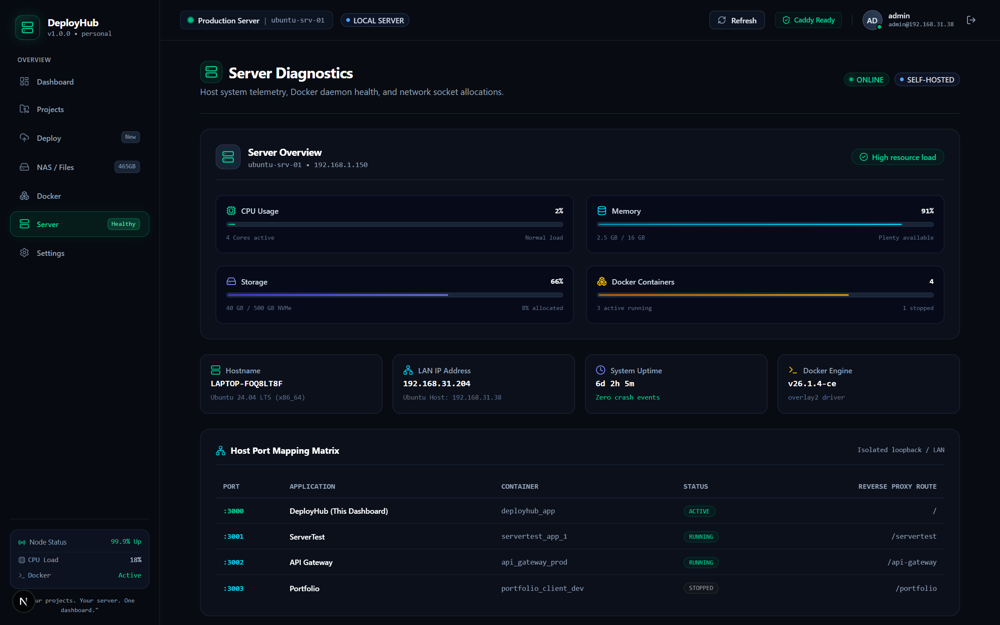
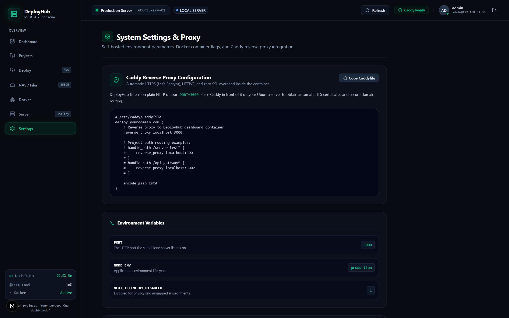

<div align="center">

# 🚀 DeployHub
### Self-Hosted Server, Docker Management & Project Deployment Platform

[-000000?style=for-the-badge&logo=nextdotjs&logoColor=white)](#)
[](#)
[](#)
[](#)
[](#)
[](#)

<p align="center">
  <b>"Your projects. Your server. One dashboard."</b><br>
  Self-hosted Ubuntu server deployment platform, host Docker manager, strictly sandboxed NAS file manager, and real-time host telemetry.
</p>

</div>

---

## 🌟 Overview & Architecture

**DeployHub** is a production-grade personal server deployment and operations platform engineered for self-hosted environments. It communicates directly with the host Docker Engine socket (`/var/run/docker.sock`), manages an isolated root filesystem mount (`/srv/storage`) alongside Windows Samba network shares, dynamically assigns collision-free host ports (`3001-3999`), and streams live build & container runtime logs.



---

## 📸 Real Project Screenshots & Visual Tour

### 1. Operations Dashboard & Mission Control
> Complete live telemetry at a glance: operational node status, running Docker containers, uninterrupted uptime metrics, NVMe storage availability, host IP binding, and active project cards.



---

### 2. Deployed Projects Management
> Dedicated service grid with real-time status badges (`RUNNING` / `STOPPED`), live memory and CPU footprint, Git branches, host port bindings, and instant Start / Stop / Logs / Open controls.



---

### 3. Zero-Downtime Deployment Pipeline
> Drag-and-drop project archive (`.zip`) uploader featuring automatic framework detection (Next.js, Vite, Node.js), smart collision-free port allocation (`3001-3999`), and step-by-step terminal log streaming.



---

### 4. Real-Time Host Docker Container Management
> Direct integration with `/var/run/docker.sock` displaying all host containers (`deployhub-core`, `servertest_app_1`, `api_gateway_prod`), health status, port mapping rules, and lifecycle controls.



---

### 5. Sandboxed NAS File Manager & Windows Samba Synergy
> Secure disk manager strictly rooted at `/srv/storage` with directory hierarchy (`projects/`, `backups/`, `shared/`), live capacity gauge, multi-file uploads, and bidirectional synchronization with Windows Samba network shares (`\\192.168.31.38\storage`).



---

### 6. Built-in Monaco Code Editor
> Full-featured VS Code-powered Monaco Editor embedded directly in the browser for editing configuration files (`Caddyfile`, `docker-compose.yml`, `server_config.json`, source code) with syntax highlighting, line numbers, unsaved indicators, and atomic writes.



---

### 7. Streaming Container Runtime Logs
> Real-time terminal log viewer providing filtered container output, timestamped traces, health check responses, network requests, and 1-click clipboard export.



---

### 8. Host Server Diagnostics & Port Matrix
> Deep server telemetry including multi-core CPU usage, RAM utilization, Linux kernel version, system uptime, and the complete host TCP socket mapping matrix (`:3000` through `:3003`).



---

### 9. System Settings & Caddy Reverse Proxy Integration
> Host environment parameters, automatic TLS reverse proxy configuration guide, storage mount paths, and security session controls.



---

## 🛠️ Core Platform Features

### 🚀 1. Real Project Deployment Pipeline
- **Drag & Drop Archive Ingestion**: Upload `.zip` archives directly to extract into `/srv/storage/projects/<slug>/`.
- **Automatic Framework Detection**: Automatically inspects package files and codebase to detect Next.js, React/Vite, Node.js, or static HTML, generating optimized multi-stage Dockerfiles on the fly.
- **Smart Port Collision Prevention**: Scans SQLite allocations, active Docker port bindings, and OS TCP sockets to automatically pick an unoccupied port between `3001` and `3999`.
- **Live Build Logs**: ANSI-styled streaming build terminal showing extraction, image layer creation, container start, and health probes.

### 🐳 2. Real Docker Daemon Management
- **Native Socket Integration**: Connects straight to `/var/run/docker.sock` via `dockerode`.
- **Container Lifecycle**: Instant Start, Stop, Restart, and Force Recreate without needing SSH.
- **Port Mapping & Stats**: Visual inspection of `:hostPort -> :containerPort` bindings and container uptime.

### 💾 3. NAS File Manager (`/srv/storage`)
- **Strict Storage Sandbox**: Secure path resolver blocks `../` traversal, symlink escapes, and unauthorized directory escapes.
- **Windows Samba Synergy**: Runs alongside Samba sharing `/srv/storage`. Edits in DeployHub immediately reflect on Windows SMB clients and vice versa.
- **Embedded Monaco Editor**: Syntax highlighting for JSON, YAML, Dockerfile, Caddyfile, Shell, TypeScript, Markdown, and Python.
- **Native Filesystem Metrics**: Real capacity and free space parsed via `fs.statfs`.

### 📊 4. Real Host Telemetry
- Multi-core CPU sampling.
- Host memory utilization via `os.totalmem()` and `os.freemem()`.
- System uptime and interface IP binding.
- Live TCP socket routing matrix.

### 🔒 5. Authentication & Hardening
- Built-in session security with `bcryptjs` password hashing and HTTP-only signed JWT cookies.
- Default administrator account: `admin` / `admin123`.

---

## 💻 Tech Stack

| Layer | Technologies |
| :--- | :--- |
| **Frontend** | [Next.js 16](https://nextjs.org/) (App Router), [React 19](https://react.dev/), [Tailwind CSS v4](https://tailwindcss.com/) |
| **Animations & Icons** | [Framer Motion](https://www.framer.com/motion/), [Lucide React](https://lucide.dev/) |
| **Code Editor** | [Monaco Editor](https://microsoft.github.io/monaco-editor/) (`@monaco-editor/react`) |
| **Backend & APIs** | Next.js Route Handlers, Node.js 22 LTS |
| **Container Engine** | Host Docker daemon via `dockerode` (`/var/run/docker.sock`) |
| **Database** | SQLite via [better-sqlite3](https://github.com/WiseLibs/better-sqlite3) (WAL mode enabled) |
| **Archive Handler** | `adm-zip` with Zip-Slip protection |
| **Reverse Proxy** | [Caddy](https://caddyserver.com/) (Automatic Let's Encrypt TLS) |

---

## 🚀 Getting Started

### Option A: Launch with Docker Compose (Recommended for Ubuntu Server)

Run directly on your self-hosted server:

```bash
# Clone the repository
git clone https://github.com/paras999000/Deployhub.git
cd Deployhub

# Start containerized DeployHub connected to host Docker socket & storage
docker compose up -d --build
```

View live container logs:
```bash
docker compose logs -f
```

Stop the platform:
```bash
docker compose down
```

### Option B: Local Development

```bash
# 1. Install dependencies
npm install

# 2. Run Turbopack development server
npm run dev

# 3. Open http://localhost:3000 in your browser
```

For production builds:
```bash
npm run build
npm start
```

---

## ⚙️ Environment Variables

| Variable | Default | Description |
| :--- | :--- | :--- |
| `PORT` | `3000` | HTTP port DeployHub listens on inside the container. |
| `STORAGE_ROOT` | `/srv/storage` | Host storage root path for projects, NAS files, and database. |
| `DOCKER_SOCKET` | `/var/run/docker.sock` | Path to host Docker daemon socket. |
| `DEPLOYHUB_SECRET` | *(auto-generated)* | Key used to sign JWT authentication tokens. |
| `NODE_ENV` | `production` | Application runtime environment. |

---

## 🌐 Caddy Reverse Proxy Setup

DeployHub is designed to sit comfortably behind Caddy with zero SSL overhead inside the container:

```caddyfile
# /etc/caddy/Caddyfile

deploy.yourdomain.com {
    reverse_proxy localhost:3000
    encode gzip zstd
}

# Subdomain or path-based project routing
# test.yourdomain.com {
#     reverse_proxy localhost:3001
# }
```

Reload Caddy instantly:
```bash
sudo systemctl reload caddy
```

---

## 🗂️ Filesystem Layout

```text
/srv/storage/
├── .deployhub/
│   └── deployhub.db       # SQLite database (projects, deployments, audit log, users)
├── projects/
│   ├── server-test/       # Extracted Next.js project
│   ├── api-gateway/       # Node.js microservice
│   └── portfolio/         # React frontend
├── backups/               # Automated and manual project snapshots
├── shared/                # Samba shared files (\\192.168.31.38\storage)
└── files/                 # General NAS files
```

---

## 📜 License

Distributed under the **MIT License**. See `LICENSE` for more information.

---

<div align="center">
  <b>DeployHub</b> — Engineered for Self-Hosters, Homelabbers, and Developers.<br>
  Built with ❤️ by <b>Paras</b>
</div>
